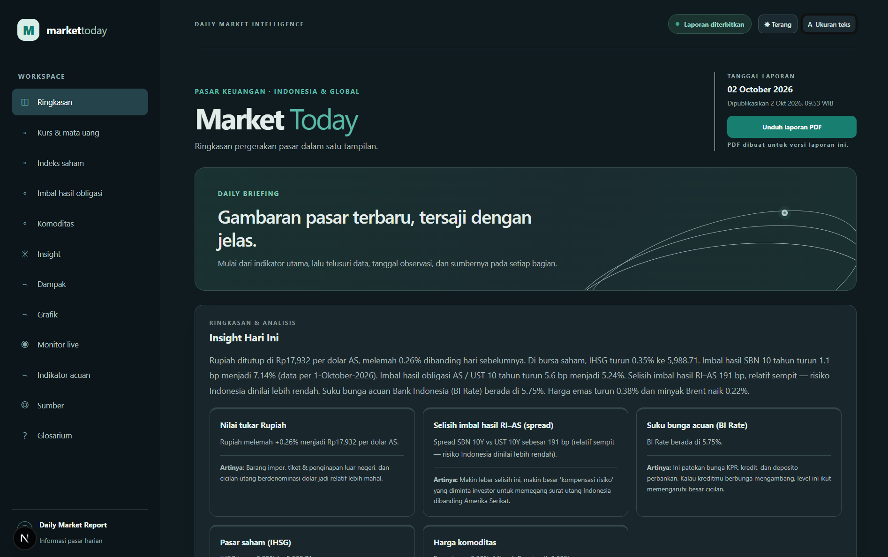
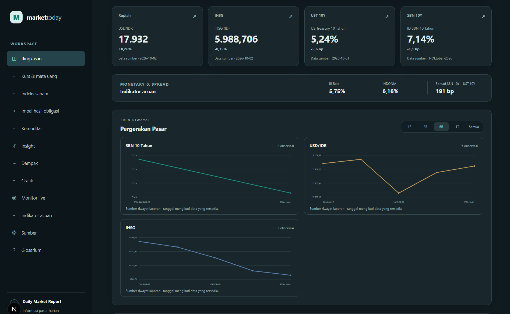

# Daily Market Report — Dashboard & Automation (Market Today)

## Preview

| Landing Page - Ringkasan Pasar | Landing Page - Detail Tren & PDF |
| :---: | :---: |
|  |  |

*Gambar menggunakan data simulasi untuk memperlihatkan tampilan aplikasi; nilainya bukan data pasar aktual.*

Aplikasi **Market Today** menyajikan data intelijen pasar keuangan Indonesia dan global secara terpadu. Sistem dibangun dengan arsitektur modern berbasis FastAPI untuk API backend berkinerja tinggi, PostgreSQL untuk katalog data time-series dan antrean job asinkron, worker latar belakang untuk refresh dan pembuatan laporan PDF eksekutif, serta antarmuka web modern berbasis Next.js 16 (React 19 / Turbopack).

```
Sumber Pasar (Yahoo Finance, PHEI, Bank Indonesia, Trading Economics)
                             ↓
         Backend Python (akuisisi + validasi + analisis)
                             ↓
         FastAPI + PostgreSQL + Worker Latar Belakang
                             ↓
         Frontend Next.js (Dashboard Web) + Ekspor PDF A4
```

---

## Acuan Dokumen

- [Project Brief](docs/PROJECT_BRIEF.md): Visi produk, peran pengguna, spesifikasi fitur, kriteria kesiapan rilis, dan roadmap pengembangan.
- [Panduan Penamaan Database](docs/panduan_penamaan.md): Standar penamaan tabel wide dan series data time-series PostgreSQL (`{cakupan}_{Subjek}_{sumber}_{frekuensi}`).

---

## Fitur Utama & Tampilan Dashboard

### 1. Grafik Interaktif Pergerakan Pasar (Google Finance Style)
- **8 Instrumen Pasar Utama**: Menampilkan IDX Composite (IHSG), USD/IDR, ID SBN 10 Tahun, US Treasury 10Y, Emas Antam 1 gr, Dow Jones Industrial, Gold Spot, dan Brent Crude dengan bentuk dan warna tombol tab yang seragam dan konsisten.
- **Tooltip Inspeksi Nilai & Tanggal**: Mengarahkan kursor/hover ke grafik menampilkan garis crosshair dan kotak tooltip informatif berisi tanggal persis dan nilai angka terformat secara real-time.
- **Filter Rentang Waktu Lengkap**: Pilihan periode rentang waktu **1H (1D), 5H (5D), 1B (1M), 6B (6M), YTD, 1T (1Y), 5T (5Y), dan MAX**.
- **Animasi Transisi Halus**: Saat berganti rentang waktu atau instrumen, garis grafik bergerak dinamis dengan animasi transisi garis dari kiri ke kanan (*animated stroke transition*).
- **Grafik Intraday Realistis (1 Hari)**: Tampilan grafik per day (1D) tetap membentuk kurva pergerakan harga yang wajar dan informatif, didukung pemformatan angka sumbu (*axes*) yang rapi dan nyaman dibaca.
- **Filter Kalender Rentang Tanggal Kustom**: Ikon kalender berfungsi penuh membuka modal interaktif untuk memilih rentang tanggal kustom (*date range picker*), dilengkapi tombol preset instan (1 Bulan, 3 Bulan, 6 Bulan, YTD, 1 Tahun, dst.), input tanggal mulai dan akhir, serta tombol reset dan terapkan.

### 2. Desain Korporat Modern (Navy & Slate Blue)
Palet warna dirancang khusus untuk dashboard keuangan profesional:
- **Sidebar**: Navy gelap (`#142338`) dengan aksen teks merek (`#8faecf`).
- **Tab & Menu Aktif**: Biru slate (`#365779`).
- **Tombol Aksi Utama**: Biru medium gelap (`#315A85`).
- **Latar Halaman**: Abu-abu dingin (`#F3F5F8`).
- **Kartu & Panel**: Putih bersih (`#FFFFFF`) dengan border halus (`#E2E8F0`).
- **Teks Utama & Pendukung**: Navy gelap (`#18283B`) dan Abu-abu slate (`#64748B`).
- **Indikator Arah Pasar**: Warna hijau dan merah dikhususkan secara ketat untuk arah kenaikan atau penurunan data pasar.

### 3. Mode Gelap Menyeluruh (Full Dark Mode)
- Seluruh area dasar layar, body, workspace, kartu, tabel, dan popover beralih secara mulus ke tema gelap navy (`#0B131E` base, `#14202E` surfaces, `#1E2C3D` borders).
- Elemen teks penting seperti *kicker* eyebrow (`PASAR KEUANGAN · INDONESIA & GLOBAL`, `UNDUH LAPORAN`), kata `Today` pada header utama, dan judul penjelas bertransisi ke warna biru muda bercahaya (`#8faecf`) yang selaras sempurna dengan logo sidebar `markettoday`.

### 4. Insight Pasar & Implikasi bagi Treasury
- **Insight Hari Ini**: Ringkasan sorotan pasar terpenting dan interpretasi dampaknya secara otomatis.
- **Panel Implikasi bagi Treasury**: Kotak wawasan berdampingan dengan tata letak simetris dan ikon terpadu. Dilengkapi tombol untuk membuka drawer samping interaktif (*slide-over drawer*) yang memuat analisis mendalam implikasi pasar, panduan posisi likuiditas/spread, serta matriks indikator yield.

### 5. Narasi Pasar Harian
- Panel narasi pasar harian terstruktur yang menyajikan rangkuman berita ekonomi makro dan pasar modal dengan penanda waktu publikasi (*publication status*) dan audit sumber rujukan.

### 6. Ekspor Laporan PDF Eksekutif
- Kartu ekspor di bagian bawah halaman memungkinkan pengunduhan dokumen PDF ringkasan eksekutif A4 satu halaman siap cetak, memuat metrik utama, grafik perbandingan yield, insight, dan ringkasan indikator pendukung.

### 7. Monitor Pasar Live (`/monitor`) & Equity Research Snapshot (`/equity-snapshot`)
- **Monitor Pasar Live**: Halaman ticker harga instraday real-time dengan pembaruan otomatis setiap 60 detik.
- **Equity Snapshot**: Halaman laporan riset saham dengan format tabular interaktif, kemampuan penyuntingan langsung (*in-place cell editing*), dan ekspor dokumen hasil suntingan ke format PDF satu halaman A4 via browser.

---

## 1. Menyiapkan Aplikasi

### Kebutuhan Sistem
- **Python**: 3.10 atau lebih baru
- **Node.js**: 20.9 atau lebih baru (npm disertakan)
- **Database**: PostgreSQL 14+ (opsional untuk mode JSON lokal, wajib untuk mode produksi)

### Langkah Instalasi

#### Windows (PowerShell)

```powershell
# 1. Siapkan virtual environment Python
py -m venv .venv
.\.venv\Scripts\python.exe -m pip install -r backend\requirements.txt

# 2. Siapkan dependensi frontend Next.js
Set-Location frontend
npm ci
if (-not (Test-Path .env.local)) { Copy-Item .env.example .env.local }
Set-Location ..

# 3. Siapkan file konfigurasi backend
if (-not (Test-Path .env)) { Copy-Item .env.example .env }
```

#### Linux / macOS

```bash
# 1. Siapkan virtual environment Python
python3 -m venv .venv
.venv/bin/python -m pip install -r backend/requirements.txt

# 2. Siapkan dependensi frontend Next.js
cd frontend && npm ci
test -f .env.local || cp .env.example .env.local
cd ..

# 3. Siapkan file konfigurasi backend
test -f .env || cp .env.example .env
```

### Konfigurasi Lingkungan (`.env` dan `.env.local`)
1. **File `.env` di root**: Isi URL koneksi PostgreSQL (`DATABASE_URL`), kredensial database, serta token rahasia `API_READ_TOKEN` dan `API_OPERATOR_TOKEN`.
2. **File `frontend/.env.local`**: Isi `DAILY_MARKET_API_URL` (default: `http://127.0.0.1:8000`), `API_READ_TOKEN` (harus sama dengan token di `.env`), serta kata sandi operator `WEB_OPERATOR_PASSWORD` dan `WEB_OPERATOR_SESSION_SECRET`.

### Terapkan Migrasi Schema Database

Jalankan perintah ini sebelum memulai aplikasi pertama kali atau setelah ada pembaruan file migrasi di `backend/migrations/`:

```powershell
.\.venv\Scripts\python.exe backend/src/market_report/apply_schema_migrations.py
```

---

## 2. Menjalankan Aplikasi

### Mode Pengembangan Otomatis (Satu Perintah)
Menjalankan API FastAPI, background worker, dan frontend Next.js sekaligus dalam satu sesi terminal Windows:

```powershell
.\run-app.ps1
```
*Script ini juga secara otomatis menjalankan scheduler background bila `REFRESH_TIMES` pada `.env` telah diisi jam valid (contoh: `08:00,16:30`).*

### Mode Produksi Lokal
Untuk menguji build teroptimasi Next.js (`npm run build` + `next start`), server Uvicorn tanpa `--reload`, dan penarikan data awal:

```powershell
.\run-production.ps1
```
*(Tambahkan flag `-SkipFetch` bila ingin melewati pembaruan data pasar saat startup).*

### Menjalankan Komponen Satu per Satu (Manual / Debugging)

1. **Jalankan Backend API FastAPI (Port 8000)**:
   ```powershell
   .\.venv\Scripts\python.exe -m uvicorn market_report.api.main:app --app-dir backend/src --host 127.0.0.1 --port 8000 --reload
   ```

2. **Jalankan Background Worker Latar Belakang**:
   ```powershell
   .\.venv\Scripts\python.exe backend/src/market_report/worker/main.py
   ```

3. **Jalankan Background Scheduler (Opsional)**:
   ```powershell
   .\.venv\Scripts\python.exe backend/src/market_report/scheduler/main.py
   ```

4. **Jalankan Frontend Next.js (Port 3000)**:
   ```powershell
   cd frontend
   npm run dev
   ```

Buka peramban di `http://localhost:3000` untuk mengakses dashboard **Market Today**.

---

## 3. Titik Akhir REST API Backend

FastAPI menyediakan dokumentasi interaktif Swagger di `http://127.0.0.1:8000/docs`:

| Metode | Endpoint | Deskripsi | Otorisasi |
|---|---|---|---|
| `GET` | `/api/v1/reports/latest` | Mengambil laporan pasar aktif terbaru | Bearer `API_READ_TOKEN` |
| `GET` | `/api/v1/reports/{report_id}` | Mengambil data versi laporan tertentu | Bearer `API_READ_TOKEN` |
| `GET` | `/api/v1/instruments/{id}/history` | Riwayat titik time-series instrumen dari versi laporan yang diminta | Bearer `API_READ_TOKEN` |
| `GET` | `/api/v1/market/live` | Kutipan pergerakan pasar live (cache in-memory 30 detik) | Bearer `API_READ_TOKEN` |
| `POST` | `/api/v1/refresh-jobs` | Memasukkan permintaan refresh data ke antrean worker | Bearer `API_OPERATOR_TOKEN` |
| `GET` | `/api/v1/jobs/{job_id}` | Memeriksa status dan log event eksekusi job | Bearer `API_OPERATOR_TOKEN` |
| `POST` | `/api/v1/reports/{report_id}/exports` | Meminta pembuatan artefak PDF laporan | Bearer `API_READ_TOKEN` |
| `GET` | `/api/v1/reports/{report_id}/exports/pdf` | Mengunduh berkas laporan PDF versi terkait | Bearer `API_READ_TOKEN` |
| `GET` | `/health` | Healthcheck status layanan backend | Publik |

---

## 4. Eksekusi Pipeline CLI

Anda dapat menjalankan pipeline akuisisi data pasar secara langsung dari baris perintah:

```powershell
# 1. Mode Demo: Menulis laporan simulasi lokal tanpa memanggil API eksternal
python backend/src/market_report/run_pipeline.py --demo

# 2. Mode Live (PostgreSQL): Memasukkan tugas refresh ke antrean worker
python backend/src/market_report/run_pipeline.py

# 3. Mode JSON Lokal Cepat: Menggunakan snapshot yang ada tanpa live fetch
python backend/src/market_report/run_pipeline.py --no-fetch
```

---

## 5. Sumber Data & Observasi Pasar

| Kategori Data | Sumber Utama | Frekuensi & Keterangan |
|---|---|---|
| **Kurs Valas & Indeks Global** (USD/IDR, EUR/IDR, JPY/IDR, DXY, IHSG, DJI) | Yahoo Finance Chart API | Real-time / delayed sesuai jam bursa aktif |
| **Imbal Hasil SBN & SBSN** (1Y s.d. 30Y) | [PHEI](https://www.phei.co.id/Data/HPW-dan-Imbal-Hasil) | Harian (publikasi sore hari kerja) |
| **Suku Bunga Kebijakan & Uang** (BI Rate, INDONIA, JISDOR) | Bank Indonesia | BI Rate berkala pasca-RDG; INDONIA harian |
| **Emas Antam (1 gram)** | Feed Seri Harga Beli Harian | Harian; observasi valid terakhir dipertahankan saat feed libur |
| **Komoditas & Kontrak Berjangka** (Gold Spot / Futures, Brent Crude, WTI) | Yahoo Finance (`GC=F`, `BZ=F`, `CL=F`) | Data market harian dan historis |
| **Batubara Newcastle & CPO** | Trading Economics | Harga acuan harian; perubahan DtD, WtD, MtD, dan YtD |

---

## 6. Struktur Direktori

```
daily_market_report/
├── docs/                      ← Dokumentasi arsitektur, panduan penamaan, & Project Brief
│   ├── PROJECT_BRIEF.md
│   ├── panduan_penamaan.md
│   └── images/
├── backend/
│   ├── migrations/            ← Berkas migrasi schema database PostgreSQL berurutan
│   ├── pyproject.toml         ← Konfigurasi packaging Python
│   ├── requirements.txt       ← Dependensi library Python backend
│   └── src/market_report/     ← API FastAPI, domain model, layanan data, worker, & pipeline
├── frontend/                  ← Aplikasi web Next.js 16 (React 19 / Turbopack)
│   ├── public/                ← Aset statis & ikon
│   ├── src/
│   │   ├── app/               ← Layout, route handler (/api), dan halaman (page.tsx, /monitor, /equity-snapshot)
│   │   ├── components/        ← Komponen bersama (topbar, dialog kalender, operator login)
│   │   └── features/          ← Fitur spesifik (dashboard, history-charts, treasury drawer, narrative panel)
│   └── package.json
├── runtime/                   ← Direktori keluaran lokal (cache data, PDF, log) [diabaikan git]
├── tests/                     ← Pengujian otomatis backend & integrasi API
├── tools/                     ← Utilitas pengembang
├── run-app.ps1                ← Launcher cepat mode pengembangan Windows
├── run-production.ps1         ← Launcher mode produksi lokal Windows
├── .env.example               ← Template konfigurasi root/backend
└── README.md
```

---

## 7. Tips Operasional & Troubleshooting

| Gejala / Pertanyaan | Solusi |
|---|---|
| **Data pasar tampak belum terbarui** | Pastikan worker berjalan (`backend/src/market_report/worker/main.py`). Klik menu **Pengelolaan** di header dashboard, masukkan kredensial operator, lalu picu **Perbarui Data**. Anda juga dapat menjalankan `run_pipeline.py`. |
| **Koneksi database error / tabel belum ada** | Jalankan skrip migrasi schema: `python backend/src/market_report/apply_schema_migrations.py`. Pastikan URL PostgreSQL pada `.env` telah sesuai dan service PostgreSQL sedang aktif. |
| **Grafik tampak datar atau titik sedikit** | Saat awal instalasi, histori lokal baru mencatat observasi terbaru. Seiring berjalannya pipeline harian, kurva riwayat terakumulasi secara bertahap hingga rentang MAX. Untuk instrumen global (IHSG, Valas, UST), histori Yahoo Finance akan otomatis mengisi hingga 5 tahun. |
| **PDF gagal diunduh** | Pastikan direktori `runtime/reports/` dapat ditulis oleh proses worker. Periksa log worker untuk memastikan komponen Chromium/ReportLab telah terpasang dengan benar. |
| **Token API tidak valid saat memuat dashboard** | Pastikan nilai `API_READ_TOKEN` pada file `frontend/.env.local` persis sama dengan nilai `API_READ_TOKEN` pada file `.env` di root proyek. |
| **Tampilan mode gelap terasa kontras di layar tertentu** | Gunakan tombol sakelar tema di pojok kanan atas untuk beralih antara Mode Terang dan Mode Gelap kapan saja. Preferensi tema tersimpan di penyimpanan lokal peramban Anda. |
