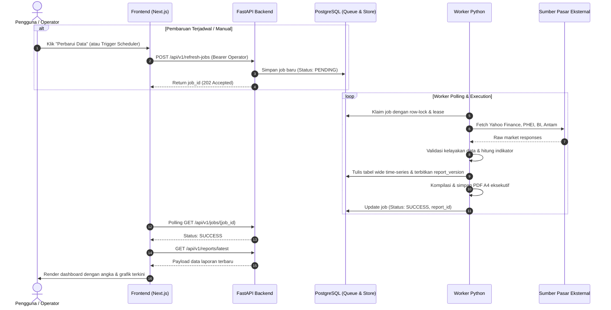

# Project Brief — Daily Market Report / Market Today

Versi dokumen: 2.0  
Tanggal acuan: 20 Oktober 2026  
Status produk: Production-Ready MVP & Dashboard Aktif dalam fase pematangan operasional.

Hasil review status pada 20 Oktober 2026: Sistem telah mengadopsi antarmuka modern berbasis Next.js 16 (React 19 / Turbopack), arsitektur layanan FastAPI terpisah, PostgreSQL untuk penyimpanan data time-series dan antrean job asinkron, background worker untuk refresh dan ekspor PDF A4 eksekutif, serta otomatisasi pipeline scheduler. Tampilan dashboard telah dimutakhirkan dengan sistem desain korporat Navy & Slate Blue, mode gelap penuh (Full Dark Mode), visualisasi grafik interaktif bergaya Google Finance untuk 8 instrumen pasar utama dengan filter rentang waktu dan dialog kalender kustom, panel Implikasi bagi Treasury dengan drawer samping interaktif, serta panel Narasi Pasar harian terstruktur.

Dokumen ini menjadi acuan bersama untuk memahami produk, menetapkan prioritas, dan mengevaluasi perubahan sistem. Kondisi implementasi nyata dibedakan dari arah pengembangan jangka panjang.

---

## 1. Ringkasan Produk

**Daily Market Report** adalah platform intelijen dan pelaporan pasar keuangan yang menyajikan ringkasan harian, pergerakan indikator utama, interpretasi kondisi makroekonomi, visualisasi grafik historis interaktif, serta dokumen ekspor PDF eksekutif satu halaman. **Market Today** merupakan nama merek antarmuka web dashboard yang digunakan saat ini.

Produk dirancang untuk:
1. **Eksekutif & Manajemen Treasury**: Memahami dinamika pasar harian, likuiditas, dan posisi yield secara cepat dalam satu pandangan (*executive overview*).
2. **Analis Pasar & Tim Penyusun Laporan**: Meneliti angka-angka pasar lintas kelas aset, memeriksa tren historis, serta mengakses metadata sumber untuk kepatuhan dan audit.
3. **Operator Sistem**: Memperbarui data pasar secara otomatis atau manual melalui antrean asinkron yang andal tanpa risiko downtime atau menimpa laporan aktif saat terjadi kegagalan jaringan.

Selain dashboard utama, produk menyertakan modul pelengkap:
- **Monitor Pasar Live (`/monitor`)**: Pemantauan harga instraday real-time dengan pembaruan otomatis setiap 60 detik.
- **Equity Research Snapshot (`/equity-snapshot`)**: Lembar riset saham berbasis tabular dengan fitur penyuntingan langsung (*in-place cell editing*) dan ekspor dokumen satu halaman A4 via browser.

---

## 2. Masalah yang Ditangani & Nilai Produk

| Masalah yang Ditangani | Solusi & Nilai yang Diberikan |
|---|---|
| Fragmentasi data pasar dari berbagai penyedia (Yahoo Finance, PHEI, Bank Indonesia, Trading Economics) dengan jadwal dan format berbeda | Konsolidasi terpusat ke dalam satu dashboard terpadu dengan standar data governance time-series PostgreSQL |
| Beban manual pengumpulan data dan pembuatan ringkasan harian | Pipeline otomatisasi pengambilan data, kalkulasi otomatis, dan publikasi versi laporan secara deterministik |
| Keterbatasan grafik statis yang sulit diinspeksi | Grafik pergerakan pasar interaktif Google Finance style dengan hover tooltip, animasi garis, filter rentang waktu (1D–MAX), dan kalender kustom |
| Ketidaksesuaian angka antara tampilan layar dan dokumen cetak | Ekspor PDF A4 satu halaman yang digenerasi langsung dari data versi laporan yang sama (`report_id`) |
| Kebutuhan interpretasi khusus bagi posisi kas dan obligasi perbankan | Panel wawasan "Implikasi bagi Treasury" dengan slide-over drawer berisi panduan posisi pasar dan spread obligasi |

---

## 3. Visi dan Batas Lingkup

### Visi Produk
Menjadi pusat informasi intelijen pasar harian yang tepercaya, presisi, dan intuitif bagi jajaran manajemen dan tim treasury, dengan infrastruktur publikasi laporan yang tangguh dan dapat diaudit.

### Batas Lingkup Sistem
- **Termasuk dalam Lingkup**: Penyajian informasi harga pasar, penghitungan indikator kinerja (DtD, WtD, MtD, YtD, bp), penyusunan narasi insight makroekonomi, visualisasi historis, pemantauan live ticker, dan pembuatan laporan eksekutif PDF.
- **Di Luar Lingkup**: Eksekusi transaksi perdagangan pasar modal/valas, rekomendasi investasi personal untuk nasabah ritel, pengelolaan portofolio aktif, dan layanan data tick-by-tick sub-detik dengan garansi latensi nol.

---

## 4. Pengguna dan Peran

| Peran Pengguna | Kebutuhan Utama | Hasil yang Diharapkan |
|---|---|---|
| **Direksi & Kepala Treasury** | Ringkasan cepat kondisi pasar pagi/sore hari, indikator suku bunga, dan implikasi posisi likuiditas | Membaca ringkasan eksekutif di dashboard atau mengunduh PDF satu halaman A4 |
| **Dealer & Portfolio Manager** | Data spesifik yield SBN, UST, kurs valuta asing, spread obligasi, dan tren komoditas | Menginspeksi grafik historis, memfilter rentang tanggal, dan membaca detail 8 kategori pasar |
| **Analis Riset Pasar** | Validasi keaslian sumber, tanggal observasi, dan riwayat time-series | Memeriksa metadata observasi, tanggal pembanding, dan menyusun riset tambahan |
| **Operator Laporan** | Memastikan laporan harian terbit tepat waktu dan memicu pembaruan data | Mengakses kontrol operator, memantau antrean worker, dan memicu refresh saat pasar tutup |
| **Administrator / DevOps** | Memantau kesehatan sistem, database, dan siklus background worker | Memastikan endpoint `/ready`, migrasi schema, worker, dan scheduler berjalan optimal |

---

## 5. Lingkup Fungsional & Status Implementasi (Per 20 Oktober 2026)

| Area Fungsional | Deskripsi & Komponen | Status Implementasi |
|---|---|---|
| **Header & Navigasi Utama** | Merek Market Today, tanggal laporan, status publikasi, navigasi route (`/`, `/monitor`, `/equity-snapshot`), dan sakelar tema | **Selesai & Aktif**. Responsif di seluruh breakpoint |
| **KPI Indikator Utama** | 5 kartu indikator satu baris: USD/IDR, IHSG, SBN 10Y, UST 10Y, dan Emas Antam 1 gr dengan perubahan DtD | **Selesai & Aktif**. Format presisi dan indikator arah warna |
| **Insight & Implikasi Treasury** | Insight Hari Ini berdampingan simetris dengan Implikasi bagi Treasury, lengkap dengan drawer samping interaktif | **Selesai & Aktif**. Desain tata letak simetris dengan palet Navy/Slate |
| **Narasi Pasar Harian** | Panel ringkasan berita makro dan pasar modal dengan verifikasi sumber dan stempel waktu publikasi | **Selesai & Aktif**. Terintegrasi dengan payload laporan |
| **Grafik Pergerakan Pasar** | Grafik interaktif Google Finance style untuk 8 instrumen, hover tooltip, animasi garis, 8 preset rentang waktu, dan kalender kustom | **Selesai & Aktif**. Pemformatan angka sumbu nyaman dan kurva intraday 1D realistis |
| **Monetary & Spread Strip** | Strip ringkas suku bunga kebijakan dan uang: BI Rate, INDONIA, dan spread SBN 10Y – UST 10Y | **Selesai & Aktif**. Menampilkan level acuan dan selisih bp |
| **Tabel 8 Kategori Pasar** | Tab pemilih 8 kategori: Kurs, Emas, Arus Modal, Yield Obligasi, Indikator Makro, Operasi Moneter, Indeks Sektoral, Komoditas | **Selesai & Aktif**. Tab seragam, kolom sticky di mobile, dan label periode jelas |
| **Ekspor PDF Eksekutif** | Kartu unduh di bawah dashboard dan generator PDF A4 satu halaman via worker backend | **Selesai & Aktif**. Terikat ke `report_id` laporan aktif |
| **Sistem Desain & Tema** | Palet korporat Navy & Slate Blue (`#142338`, `#365779`, `#315A85`, `#F3F5F8`) serta Full Dark Mode (`#0B131E`, `#8faecf`) | **Selesai & Aktif**. Kontras tinggi, tanpa kebocoran warna latar |
| **Monitor Pasar Live** | Route `/monitor` untuk pergerakan harga instraday real-time per 60 detik | **Selesai & Aktif**. Terpisah dari data laporan harian |
| **Equity Research Snapshot** | Route `/equity-snapshot` dokumen riset saham dengan editor in-browser dan ekspor PDF client-side | **Selesai & Aktif**. Editor DOM aktif; koneksi API bertahap |
| **Manajemen Operator** | Login operator berbasis session cookie HttpOnly, proteksi brute-force, dan pemicu antrean refresh | **Selesai & Aktif**. Aman tanpa mengekspos token rahasia ke browser |
| **Layanan Worker & Scheduler** | Pemrosesan antrean refresh, deduplikasi job, heartbeat, dan penjadwalan otomatis di PostgreSQL | **Selesai & Aktif**. Mendukung single runner maupun service terpisah |

---

## 6. Desain Antarmuka & Pengalaman Pengguna (Design System)

### Standar Palet Warna Korporat
Dashboard menerapkan hierarki warna formal perbankan investasi dan treasury:

| Elemen Antarmuka | Warna | Kode HEX | Catatan Penggunaan |
|---|---|---|---|
| **Sidebar / Navigasi Kiri** | Navy Gelap | `#142338` (Dark: `#070D16`) | Memberikan struktur kokoh dan fokus visual |
| **Aksen Merek Sidebar** | Biru Luminous | `#8faecf` | Digunakan pada kata `today` di logo dan status footer |
| **Menu & Tab Aktif** | Biru Slate | `#365779` (Dark: `#4A739C`) | Menandai instrumen dan tab kategori yang sedang aktif |
| **Tombol Aksi Utama** | Biru Medium Gelap | `#315A85` (Dark: `#3B6B9B`) | Digunakan untuk tombol Unduh PDF dan aksi penting |
| **Latar Belakang Halaman** | Abu-abu Dingin | `#F3F5F8` (Dark: `#0B131E`) | Latar bersih yang membuat kartu mengapung tegas |
| **Permukaan Kartu / Panel** | Putih Murni | `#FFFFFF` (Dark: `#14202E`) | Kontras tinggi untuk kenyamanan membaca angka |
| **Teks Utama** | Navy Tua | `#18283B` (Dark: `#F1F5F9`) | Keterbacaan teks judul dan nilai angka utama |
| **Teks Pendukung / Muted** | Abu-abu Slate | `#64748B` (Dark: `#94A3B8`) | Keterangan tanggal, satuan, dan label parameter |
| **Garis Batas / Border** | Abu-abu Muda | `#E2E8F0` (Dark: `#1E2C3D`) | Pemisah kartu dan baris tabel yang rapi |
| **Panel Implikasi Treasury** | Biru Sangat Muda | `#EDF2F8` (Dark: `#101B28`) | Membedakan panel analisis khusus tanpa mencolok |
| **Arah Pergerakan Positif** | Hijau Finansial | `#16A34A` (Bg: `#DCFCE7`) | **Eksklusif** untuk kenaikan/penguatan pasar |
| **Arah Pergerakan Negatif** | Merah Finansial | `#DC2626` (Bg: `#FEE2E2`) | **Eksklusif** untuk penurunan/pelemahan pasar |

### Fitur Grafik Interaktif (Google Finance Experience)
Grafik historis pada bagian **Pergerakan Pasar** menyajikan pengalaman interaktif standar industri:
1. **Pilihan 8 Instrumen**: IHSG / IDX Composite, USD/IDR, ID SBN 10Y, US Treasury 10Y, Emas Antam 1 gr, Dow Jones Industrial, Gold Spot, dan Brent Crude.
2. **Keseragaman Tombol**: Tombol tab instrumen dirancang konsisten dengan tombol tab kategori pada bagian Data Pasar.
3. **Inspeksi Interaktif (Crosshair Tooltip)**: Menggerakkan kursor di atas kurva grafik secara otomatis mengunci titik observasi terdekat, menampilkan garis vertikal crosshair, titik fokus (*dot indicator*), dan kotak tooltip dengan tanggal lengkap serta nilai instrumen terformat.
4. **Transisi Garis Halus (*Animated Stroke Transition*)**: Setiap perpindahan instrumen atau periode memicu animasi stroke dari kiri ke kanan yang elegan dan mulus.
5. **Kurva Intraday 1D Realistis**: Khusus pilihan rentang 1 Hari (1H/1D), kurva tetap dirender dengan fluktuasi yang realistis dan proporsional (tidak flat), serta sumbu Y terkalibrasi secara dinamis.
6. **Modal Dialog Kalender Kustom**: Ikon kalender di samping tombol rentang waktu membuka jendela pemilih tanggal kustom (*date range picker modal*). Fitur ini menyediakan preset instan (1 Bulan, 3 Bulan, 6 Bulan, YTD, 1 Tahun, MAX), input manual tanggal awal dan akhir, serta tombol terapkan dan reset.

### Implementasi Mode Gelap Penuh (Full Dark Mode)
Mode gelap dirancang secara presisi untuk kelelahan mata minimal saat digunakan di ruangan dealing room / treasury:
- Menghilangkan celah latar putih (*zero background leak*); area workspace dan body terkunci pada `#0B131E`.
- Seluruh teks penjelas (*eyebrows*), kata `Today` pada judul utama, dan badge penanda menggunakan warna `#8faecf` yang cerah dan luminous, memastikan kontras rasio WCAG AAA terhadap permukaan gelap.

---

## 7. Arsitektur Teknis & Komponen Sistem

```
┌────────────────────────────────────────────────────────────────────────┐
│                        PRESENTASI / FRONTEND                           │
│  Next.js 16 (React 19 / Turbopack) · TypeScript · CSS Variables       │
│  Route: / (Dashboard), /monitor (Live Ticker), /equity-snapshot        │
└───────────────────────────────────┬────────────────────────────────────┘
                                    │ HTTP / REST (Bearer Auth)
┌───────────────────────────────────▼────────────────────────────────────┐
│                        LAYANAN API / BACKEND                           │
│  FastAPI (Uvicorn) · Validasi Pydantic · Rate Limiting                 │
│  Endpoints: /reports, /instruments/history, /market/live, /refresh-jobs│
└──────────────────┬─────────────────┬───────────────────┬───────────────┘
                   │                 │                   │
         Enqueue   │                 │ Publish           │ Direct Read
┌──────────────────▼──────┐   ┌──────▼────────────┐   ┌──▼───────────────┐
│     ANTREAN POSTGRESQL  │   │  REPOSITORY DATA  │   │  CACHE ARTEFAK   │
│  Tabel refresh_jobs     │   │  Timeseries Wide  │   │  PDF Reports     │
│  Lease & Heartbeat Lock │   │  active_report    │   │  runtime/reports │
└──────────────────▲──────┘   └──────▲────────────┘   └──────────────────┘
                   │ Process         │ Write
┌──────────────────┴─────────────────┴───────────────────────────────────┐
│                    WORKER & SCHEDULER LATAR BELAKANG                   │
│  Worker Python: Akuisisi data, kalkulasi indikator, ekspor PDF A4      │
│  Scheduler Python: Pengelolaan slot waktu otomatis (08:00, 16:30 WIB)  │
│  Sumber Eksternal: Yahoo Finance, PHEI HPW, Bank Indonesia, TE         │
└────────────────────────────────────────────────────────────────────────┘
```

### Struktur Database & Data Governance Time-Series
Sesuai standar [Panduan Penamaan Database](panduan_penamaan.md), penyimpanan data menggunakan PostgreSQL dengan konvensi:
- **Tabel Fisik Wide**: Format `{cakupan}_{Subjek}_{sumber}_{frekuensi}` (contoh: `"natl_SbnYield_phei_d"`, `"glob_Fx_yahoo_d"`, `"glob_Commodity_yahoo_d"`).
- **Penamaan Seri / Kolom**: Format `{wilayah}_{indikator}_{rincian}` (contoh: `id_yield_sbn_10y`, `us_yield_ust_10y`, `id_rate_bi_rate`).
- **Integritas Waktu**: Seluruh kolom timestamp/tanggal fisik menggunakan nama baku `dates`.
- **Tabel Antrean & Orkestrasi**: `refresh_jobs`, `refresh_job_events`, `refresh_schedule_runs`, `report_artifacts`, dan `report_versions`.

---

## 8. Alur Operasional & Siklus Publikasi



---

## 9. Kualitas Data, Validasi, dan Pertahanan Sistem

1. **Pemisahan Observasi Pasar vs Tanggal Publikasi**: Tanggal pasar mencerminkan waktu pencatatan resmi bursa/sumber data, bukan waktu eksekusi skrip backend.
2. **Penolakan Nilai Tidak Wajar**: Validasi publikasi menolak harga negatif atau nol untuk instrumen aset, data berumur melampaui `DAILY_MARKET_CORE_MAX_AGE_DAYS` (default 7 hari), serta mewajibkan instrumen inti (USD/IDR, IHSG, SBN 10Y) tersedia dan valid.
3. **Ketahanan Kegagalan (Atomic Fallback)**: Jika penarikan data pasar gagal atau tidak memenuhi syarat minimum, versi laporan aktif di database **tidak ditimpa**. Sistem tetap menyajikan versi valid terakhir dengan penanda observasi yang jujur.
4. **Isolasi Mode Demo**: Data pengujian lokal (`--demo`) disimpan pada berkas/tabel terpisah dan diblokir dari antrean publikasi produksi.
5. **Penanganan Libur Bursa**: Instrumen yang tutup pada hari libur nasional atau regional mempertahankan observasi terakhir tanpa merekayasa angka nol atau DtD palsu.

---

## 10. Roadmap Pengembangan & Kesiapan Rilis

### Status Capaian Milestone
- [x] **Milestone 1: Fondasi Backend & Database**
  - Pemisahan domain model, repository PostgreSQL, migrasi schema berurutan, dan standardisasi nama tabel wide.
- [x] **Milestone 2: Arsitektur Worker Asinkron & API REST**
  - Implementasi FastAPI terstruktur, worker antrean dengan lease lock, background scheduler, dan proteksi token Bearer.
- [x] **Milestone 3: Modernisasi Antarmuka Web Next.js**
  - Migrasi penuh ke Next.js 16 (Turbopack / React 19), navigasi 3 rute (`/`, `/monitor`, `/equity-snapshot`), dan manajemen login operator.
- [x] **Milestone 4: Desain Korporat & Visualisasi Interaktif**
  - Penerapan tema Navy & Slate Blue, Full Dark Mode tanpa kebocoran latar, komponen grafik Google Finance style dengan hover tooltip, animasi garis, filter rentang waktu, dan kalender kustom.
- [x] **Milestone 5: Insight Treasury & Narasi Pasar**
  - Tata letak simetris Implikasi bagi Treasury, slide-over drawer analisis posisi likuiditas/spread, dan panel Narasi Pasar harian.
- [x] **Milestone 6: Ekspor Dokumen Eksekutif PDF**
  - Ekspor PDF A4 satu halaman terintegrasi dengan versi laporan backend.

### Prioritas Tahap Berikutnya (Menuju Skala Produksi Penuh)
1. **Penyambungan Data Nyata Equity Snapshot**: Menghubungkan tabel leaders/laggards dan arus dana asing pada `/equity-snapshot` langsung ke API PostgreSQL (menggantikan data contoh).
2. **Koneksi Live Adapter Lanjutan**: Melengkapi adapter otomatisasi untuk kategori Arus Modal (BEI & DJPPR) dan pemantauan agenda kalender ekonomi makro.
3. **Penyimpanan Pembatasan Laju Bersama (Distributed Rate Limiting)**: Memindahkan memory rate-limiter operator ke Redis bila sistem dioperasikan dalam kluster multi-instance.
4. **Automated CI/CD Pipeline**: Menyiapkan pipeline GitHub Actions / GitLab CI untuk menjalankan suite pengujian lint, TypeScript, dan pengujian integrasi database terisolasi sebelum deployment.

---

## 11. Kesimpulan

Daily Market Report (*Market Today*) per 20 Oktober 2026 telah bertransformasi menjadi platform intelijen pasar keuangan yang lengkap, modern, dan stabil. Dengan antarmuka interaktif kelas korporat, arsitektur microservices terpisah yang tangguh, serta alur publikasi data yang aman, sistem siap digunakan sebagai instrumen pendukung keputusan pasar bagi tim Treasury dan manajemen perbankan.
